<div align="center">

<!-- Header Banner -->


<br/>

<!-- Dynamic Animated Typing Header -->
<a href="https://github.com/Harika-reddy2628">
  
</a>

<br/>

<!-- Social & Badges Row -->
<p align="center">
  <a href="https://linkedin.com/in/harikareddy" target="_blank">
    
  </a>
  <a href="https://huggingface.co/harikareddy" target="_blank">
    
  </a>
  <a href="mailto:duddekuntahaari@gmail.com">
    
  </a>
  <a href="https://github.com/Harika-reddy2628">
    
  </a>
</p>

</div>

---

### ⚡ Executive Overview

```yaml
identity:
  name: Duddekunta Harika Reddy
  location: Hyderabad, India
  education: B.Tech in Computer Science & Engineering (AI) @ NxtWave IAT (2025–2029)
  specialization: Agentic AI Systems • Deterministic Safety Guardrails • Python Infrastructure

engineering_philosophy:
  focus: "Bridging non-deterministic LLM reasoning with mission-critical, fail-safe backend systems."
  protocols: [Model Context Protocol (MCP), ISO 8583, Cursor-on-Target (CoT) XML]
  safety: "Policy Enforcement Points (PEP) • Zero-Leak Security • Schema-Validated Execution"
```

I build **autonomous agentic architectures** and **deterministic backend systems**. My work focuses on constructing AI agents that don't hallucinate outside mission boundaries—enforcing strict mathematical and regulatory guardrails around LLM outputs.

- 🛡️ **Autonomous Recovery**: Core developer of **PulseGuard AI / Smart Retry Guard**, an ISO 8583-compliant payment recovery system with non-AI Policy Enforcement Point (PEP) circuit breakers.
- 🛸 **Swarm Architecture**: Subsystem Lead for **Project SUTRA** (Swarm Unified Tactical Reconnaissance Architecture) — Grand Finalist at the **Smart Horizon 2026 International 48-Hour Hackathon**.
- 📐 **Spatial Pipelines**: Architect of **Anvaya-CLI**, turning raw 2D blueprints into Draco-compressed 3D assets via Gemini Vision OCR and headless Blender compilation.

---

### 🚀 Flagship Engineering Projects

<table>
  <tr>
    <td width="50%" valign="top">
      <h3>🛡️ <a href="https://github.com/Harika-reddy2628/smart-retry-guard">PulseGuard AI (Smart Retry Guard)</a></h3>
      <p><em>AI-proposed recurring payment recovery with deterministic ISO 8583 banking safety guardrails.</em></p>
      <ul>
        <li><b>ISO 8583 Parser:</b> Automatically translates raw card network decline codes into root-cause recovery contexts.</li>
        <li><b>Deterministic PEP Circuit-Breaker:</b> Enforces non-negotiable Visa/Mastercard 15-attempt/30-day limits, blocking 100% of illegal retries.</li>
        <li><b>Automated Pytest Harness:</b> End-to-end simulation verifying hard decline blocks, exponential backoff, and dunning workflows.</li>
      </ul>
      <p>
        
        
        
        
      </p>
    </td>
    <td width="50%" valign="top">
      <h3>🛸 <a href="https://github.com/Harika-reddy2628/SUTRA-PPT">Project SUTRA</a></h3>
      <p><em>Autonomous Multi-UAV Swarm Architecture in GPS-denied environments (Grand Finalist @ Smart Horizon Hackathon).</em></p>
      <ul>
        <li><b>Verification &amp; CONOPS:</b> Led Subsystem E, designing fail-safe operational state machines for contested disaster zones.</li>
        <li><b>Tactical Telemetry:</b> Ingested tri-modal sensor telemetry into a 3D WebGPU GCS formatting MIL-STD CoT XML feeds at 60 FPS.</li>
        <li><b>Edge Optimization:</b> Validated swarm execution across ESP32-S3 companion units, cutting operational unit cost by &gt;80%.</li>
      </ul>
      <p>
        
        
        
        
      </p>
    </td>
  </tr>
  <tr>
    <td width="50%" valign="top">
      <h3>📐 <a href="https://github.com/Harika-reddy2628/anvaya">Anvaya-CLI &amp; Spatial 3D Pipeline</a></h3>
      <p><em>Multimodal blueprint extraction and automated headless 3D mesh compilation engine.</em></p>
      <ul>
        <li><b>Vision Extraction:</b> Leveraged Gemini Vision OCR to parse PDF blueprints into standardized SI metric CAD/BIM schemas.</li>
        <li><b>Headless Blender Compilation:</b> Automated Draco geometry compression via gltf-transform for real-time mobile WebGL rendering.</li>
        <li><b>Anti-Leak Protocol:</b> Enforced strict POSIX 0600 file permission validation before syncing asset catalogs to Hugging Face Hub.</li>
      </ul>
      <p>
        
        
        
      </p>
    </td>
    <td width="50%" valign="top">
      <h3>💳 <a href="https://github.com/Harika-reddy2628/smart-savings-advisor">Smart Savings Advisor</a></h3>
      <p><em>Student-focused expense tracking and behavioral financial management platform.</em></p>
      <ul>
        <li><b>Spending Analytics:</b> Tracks spending velocity and detects recurring anomalous subscription charges.</li>
        <li><b>Milestone Goal Engine:</b> Real-time progress tracking with automated micro-saving projections and budget allocations.</li>
        <li><b>Modern Responsive UI:</b> Built with a clean, mobile-first design system using Tailwind CSS and React.</li>
      </ul>
      <p>
        
        
        
      </p>
    </td>
  </tr>
</table>

---

### 🛠️ Tech Arsenal

<div align="center">

| Domain | Technologies &amp; Tools |
| :--- | :--- |
| **Agentic AI &amp; Protocols** |       |
| **Languages &amp; Core** |       |
| **Backend &amp; Ingestion** |       |
| **Frontend &amp; Graphics** |      |
| **DevOps &amp; Infrastructure** |      |

</div>

---

### 🏆 Honors &amp; Verified Certifications

- 🥇 **Grand Finalist — Smart Horizon 2026 International 48-Hour Hackathon**: Selected for Grand Finale showcase with **Project SUTRA** (autonomous multi-UAV reconnaissance swarm in GPS-denied environments).
- 🎖️ **NPTEL Elite Certification (Score: 76%)**: Professional Communication & Cross-Functional Team Leadership from IIT Kharagpur/Madras.
- ☁️ **Google Cloud Skills Boost**: Agentic AI Engineering & Containerized Cloud Run Deployment.
- ⚡ **AMD AI Academy**: Autonomous Agents 101 Certification.

---

### 📊 GitHub Activity &amp; Insights

<div align="center">

<table border="0">
  <tr>
    <td align="center" width="50%">
      
    </td>
    <td align="center" width="50%">
      
    </td>
  </tr>
  <tr>
    <td colspan="2" align="center">
      
    </td>
  </tr>
</table>

</div>

---

<div align="center">

> *"Deterministic safety guardrails don't constrain intelligence — they give autonomous agents the confidence to move at production velocity."*

<br/>

**Let's build together:**  
📫 [duddekuntahaari@gmail.com](mailto:duddekuntahaari@gmail.com) • 💼 [linkedin.com/in/harikareddy](https://linkedin.com/in/harikareddy) • 🤗 [huggingface.co/harikareddy](https://huggingface.co/harikareddy)

</div>
