<div align="center">

<!-- Header Banner -->


<br/>

<!-- Dynamic Animated Typing Header -->
<a href="https://github.com/Harika-reddy2628">
  
</a>

<br/>

<!-- Badges & Social Links -->
<p align="center">
  <a href="https://harika-reddy2628.github.io/harika-tracker/" target="_blank">
    
  </a>
  <a href="https://linkedin.com/in/harikareddy" target="_blank">
    
  </a>
  <a href="https://huggingface.co/harikareddy" target="_blank">
    
  </a>
  <a href="mailto:duddekuntahaari@gmail.com">
    
  </a>
</p>

</div>

---

### 👋 Hi, I'm Harika Reddy

I am a **Computer Science undergraduate specializing in Artificial Intelligence** at **NxtWave Institute of Advanced Technologies (IAT)**, Hyderabad.

I love exploring how intelligent systems work under the hood—from mathematical foundations and data analysis to neural networks, model fine-tuning, and practical agent workflows. I believe in **learning in public**, writing clean and tested code, and staying disciplined through daily practice.

```yaml
profile:
  name: "Duddekunta Harika Reddy"
  role: "AI & Software Engineering Student"
  location: "Hyderabad, India"
  education: "B.Tech CSE (Artificial Intelligence) @ NxtWave IAT"
  current_focus: "13-Week Deep Learning Sprint (Python → PyTorch → Transformers)"
  tracker: "https://harika-reddy2628.github.io/harika-tracker/"
```

---

### 📈 Current Learning Focus: 13-Week Deep Learning Sprint

I am currently undertaking a structured 13-week technical sprint (Nov 2026 – Feb 2027) covering foundational and applied deep learning:

- 🐍 **Phase 1 (Weeks 1–3):** Python mastery, OOP, algorithms, and Git/GitHub fundamentals.
- 📊 **Phase 2 (Weeks 4–5):** NumPy, linear algebra (3Blue1Brown), pandas, EDA → **Project A: Public Data Analysis**.
- 🧠 **Phase 3 (Weeks 6–9):** Classical ML, gradient descent, neural network math, PyTorch foundations.
- 👁️ **Phase 4 (Weeks 10–11):** CNNs & transfer learning → **Project B: Live Image Classifier on Hugging Face Spaces**.
- 💬 **Phase 5 (Weeks 12–13):** NLP, Transformer architectures → **Project C: Fine-tuned text model & portfolio**.

> 💡 *My daily practice, problem sets, and commit milestones are tracked live on my [Public Sprint Tracker](https://harika-reddy2628.github.io/harika-tracker/).*

---

### 🚀 Featured Projects

<table>
  <tr>
    <td width="50%" valign="top">
      <h3>🛡️ <a href="https://github.com/Harika-reddy2628/smart-retry-guard">Smart Retry Guard (PulseGuard)</a></h3>
      <p><em>Payment recovery prototype exploring rule-based safety guardrails and adaptive retry logic.</em></p>
      <ul>
        <li>Analyzes transaction decline codes to suggest non-intrusive retry intervals.</li>
        <li>Implements deterministic limits to prevent spamming payment gateways.</li>
        <li>Built with automated pytest unit testing for edge case validation.</li>
      </ul>
      <p>
        
        
        
      </p>
    </td>
    <td width="50%" valign="top">
      <h3>🛸 <a href="https://github.com/Harika-reddy2628/SUTRA-PPT">Project SUTRA — Swarm Reconnaissance Concept</a></h3>
      <p><em>Multi-agent coordination architecture designed for GPS-denied environments.</em></p>
      <ul>
        <li><b>Grand Finalist @ Smart Horizon 2026:</b> Selected for the international 48-hour hackathon Grand Finale showcase.</li>
        <li>Designed coordination logic and verification checkpoints for multi-agent workflows.</li>
        <li>Explored low-latency state synchronization across simulated nodes.</li>
      </ul>
      <p>
        
        
        
      </p>
    </td>
  </tr>
  <tr>
    <td width="50%" valign="top">
      <h3>💰 <a href="https://github.com/Harika-reddy2628/smart-savings-advisor">Smart Savings Advisor</a></h3>
      <p><em>Student-focused budgeting and expense tracking application.</em></p>
      <ul>
        <li>Helps college students monitor daily expenses and set realistic savings targets.</li>
        <li>Provides clear visual breakdowns of category spending patterns.</li>
        <li>Clean, responsive interface focused on usability and simplicity.</li>
      </ul>
      <p>
        
        
        
      </p>
    </td>
    <td width="50%" valign="top">
      <h3>⚡ <a href="https://github.com/Harika-reddy2628/harika-roadmap">Sprint Tracker &amp; Automation</a></h3>
      <p><em>Automated, publicly deployed tracking system for my 13-week study roadmap.</em></p>
      <ul>
        <li>Automatically aggregates daily commit activity and practice problem counts.</li>
        <li>Scheduled via GitHub Actions 7×/day and hosted on GitHub Pages.</li>
        <li>Zero manual logging: real accountability visible in real time.</li>
      </ul>
      <p>
        
        
        
      </p>
    </td>
  </tr>
</table>

---

### 🛠️ Technical Toolbox

<div align="center">

| Area | Technologies |
| :--- | :--- |
| **Languages &amp; Fundamentals** |      |
| **Machine Learning &amp; Data** |      |
| **Web &amp; Prototyping** |     |
| **Tools &amp; Workflow** |     |

</div>

---

### 🏆 Achievements & Certifications

- 🥇 **Grand Finalist — Smart Horizon 2026 International 48-Hour Hackathon**: Showcased **Project SUTRA** (swarm reconnaissance concept) before an international jury.
- 🎖️ **NPTEL Elite Certification (Score: 76%)**: Professional Communication & Cross-Functional Team Leadership from IIT Kharagpur/Madras.
- ⚡ **AMD AI Academy**: Autonomous Agents 101 Certification.
- ☁️ **Google Cloud Skills Boost**: Cloud Computing & Application Fundamentals.

---

### 📊 GitHub Activity

<div align="center">

<table border="0">
  <tr>
    <td align="center" width="50%">
      
    </td>
    <td align="center" width="50%">
      
    </td>
  </tr>
</table>

</div>

---

<div align="center">

*"Real learning is in the daily practice and the code that runs."*

<br/>

**Let's connect:**  
📫 [duddekuntahaari@gmail.com](mailto:duddekuntahaari@gmail.com) • 💼 [linkedin.com/in/harikareddy](https://linkedin.com/in/harikareddy) • 📈 [13-Week Sprint Tracker](https://harika-reddy2628.github.io/harika-tracker/)

</div>
